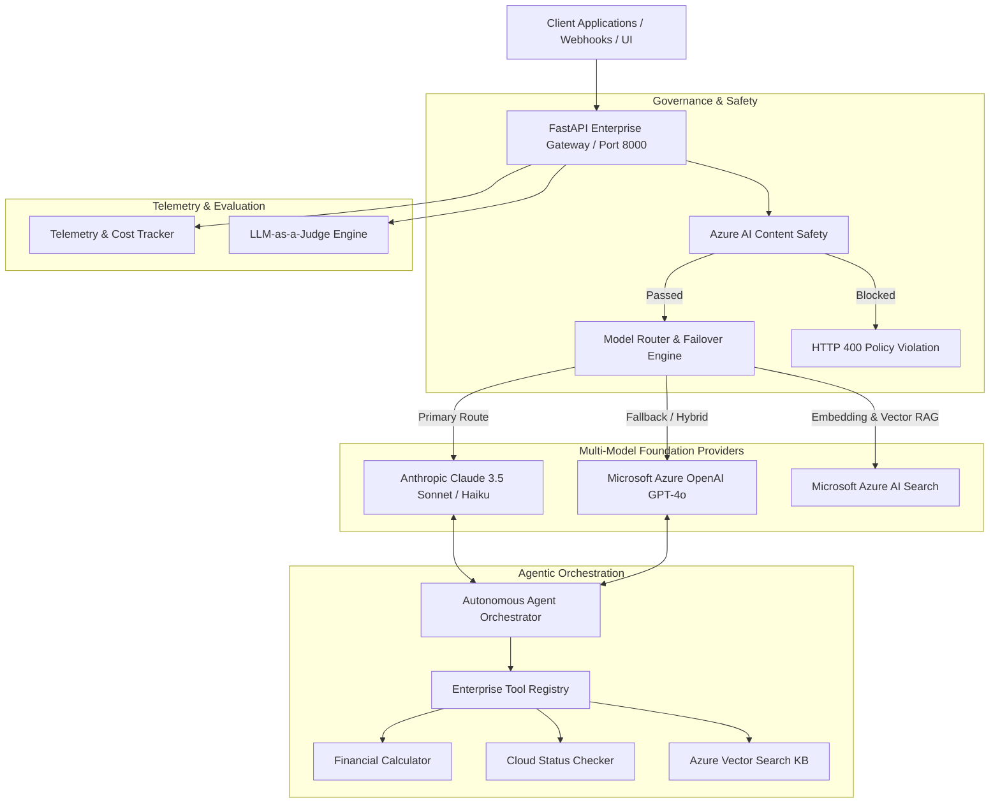

# System Architecture & Technical Specifications

This platform provides an enterprise abstraction gateway across **Anthropic Claude** foundation models and **Microsoft Azure AI Services**, ensuring mission-critical reliability, automated failover, input/output safety guardrails, and real-time observability.

---

## 1. High-Level System Architecture

---

## 2. Core Architectural Pillars

### A. Provider Abstraction Layer (`app/providers/base.py`)
All foundation models implement `BaseLLMProvider`, establishing a unified interface for:
* Message normalization (translating OpenAI chat format to Anthropic's alternating role schema).
* Tool/function calling definition conversion.
* Token count calculation and standardized latency metrics.

### B. High-Availability Routing & Automatic Failover (`app/providers/router.py`)
Enterprise production systems cannot tolerate provider outages. The `ModelRouter` monitors HTTP status codes and API exceptions:
1. When the primary provider encounters `HTTP 429` (Rate Limit) or `HTTP 503` (Service Unavailable), the router triggers **instant fallback** to the secondary provider.
2. Metadata records `failover_triggered: true` and the underlying primary error cause for audits.

### C. Enterprise Hybrid Retrieval (RAG) with Azure AI Search (`app/providers/azure_search.py`)
Retrieval combines two complementary search paradigms:
* **Dense Vector Search**: Powered by Azure OpenAI `text-embedding-3-small` (1536-dimensional embeddings) with cosine similarity.
* **Full-Text Lexical Ranking**: BM25 keyword matching for exact technical terms and identifiers.
* **Fusion**: Merges dense and lexical results with configurable weighting, achieving superior Recall@K and Precision@K.

### D. Multi-Turn Agentic Tool Execution (`app/agents/orchestrator.py`)
Instead of single-turn prompting, the agentic loop iteratively executes:
1. `User Goal` $\rightarrow$ Model inspects available tool JSON schemas.
2. Model emits structured `tool_calls`.
3. Orchestrator executes tool function in secure sandbox.
4. Tool observation returned to model context $\rightarrow$ Synthesizes verified answer with zero hallucination.

### E. Telemetry, Cost Attribution & Observability (`app/core/telemetry.py`)
* Tracks per-model token consumption (Prompt Tokens, Output Tokens, Cached Tokens).
* Real-time calculation of USD expenditure using current Anthropic & Azure pricing tiers.
* Thread-safe in-memory tracking with aggregated summaries.
